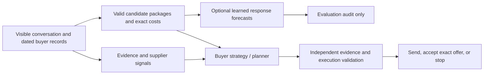

# Built-in P10/P18 decision support

## October 25 P10-only adaptive experiments

The user stopped P18 experiments. Existing cross-case histories and dated business
records remain training inputs. The latest experimental bundle is
`data/local/custom-p10-p18-v6-after-i08/model.json`; its checksum and provenance are
recorded in [latest-model.json](../reports/p10-p18-adaptive-v5/latest-model.json).
It includes all eight adaptive sessions, including the failed session's observed
responses. Focused training uses 284 exchanges from 120 sessions. The general-data
comparison covers 786 exchanges from 250 usable sessions across 12 cases. These
counts describe separate scopes, not additional independent observations.

P10's moderate EUR29.89 opening followed by EUR31.07 closed at EUR31.40/54 days
and scored69.43. A fresh EUR27.50 opening immediately elicited a final EUR31.70
offer, leaving no second negotiation turn; the accepted deal scored67.09. Both
met must-haves. This is an exploratory comparison with different adaptive model
weights, not a randomized causal estimate. See
[the result and quote sequences](../reports/p10-p18-adaptive-v5/p10-lowball-results.json).

A higher EUR30.50 opening, preserving the same staged commitment, closed at
EUR31.50/54 days and scored68.65. See
[the higher-opening result](../reports/p10-p18-adaptive-v5/p10-higher-results.json).
It was also evaluated before refitting. Neither anchor variation beat the latest
moderate-opening result. A separate first-proposal-finality model was trained to
avoid mixing opening risk with naturally final later turns. Its chronological
validation set contained no terminal replies and its test set only two, so it
remains offline despite better test error than the simple prior.

Both runs were evaluated against their pre-run weights before retraining. A new
accepted-deal cost head initially passed historical gates, but its EUR22,945.65
prediction error on the lowball run exposed weakness. After refitting, it failed
the recent-five-session baseline gate and is disabled in the latest bundle.
It estimates cost conditional on agreement, never agreement probability or causal
strategy value. Historical examples now prefer recent sessions within equal
state-distance ties; state similarity remains the primary retrieval criterion.

The registered default remains v3 and normal buyers remain in shadow mode.
New model fitting has not established improved negotiation outcomes or score72.
The sections below document earlier checkpoints, with their original counts.

## October 25 v4 training and prospective experiment

The new candidate is saved separately at
`data/local/custom-p10-p18-v4-frozen/model.json`. The registered default remains
the v3 bundle described below; normal buyers still use shadow forecasts.
The v4 experiment is recorded in
[the trial ledger](../reports/p10-p18-target72-v4/trials.json) and
[the frozen configuration](../reports/p10-p18-target72-v4/freeze.json).

The final training corpus contains **754 public exchanges from 236 sessions across
12 cases**. The candidate's predictors use **252 P10/P18 exchanges from
106 sessions**. Broader history and shared dated business records were included in
the comparison; broader-history variants did not pass the selection gates. The
P10 tactical predictor uses business context and actual email/evidence features.
The refitted P18 baseline was retained because the selected tactical candidate
increased held-out absolute error. General data is evaluated, not forced into a
predictor when the available measurements reject it.

Sixteen tactical features describe cited source types, new versus repeated
evidence, actual email length, reciprocal trades, commitments and source delivery.
Up to three nearby historical experiences from different sessions supplement the
strategy. Historical source text remains untrusted evidence. Complete historical
emails can be forecast against current conversation state only when their terms
pass current limits. Predictions do not transfer to edited emails. Neutral package
templates can abstain when their wording lies outside the trained feature range.

Training compares against the current context-aware incumbent, requires at least
5% validation MSE improvement, and rejects held-out MSE or MAE regression. Binary
targets without adequate class support remain withheld. These historical partitions
are development evidence, not independent proof of improved negotiation scores.

The user authorized exactly twelve new hosted negotiations, six per case; all twelve
are complete. Three development sessions per case preceded a final refit. Three P10
and two P18 sessions validated frozen model weights, strategy, execution policy,
backend settings, Python source and reference data. After the user's evidence and
keyword request, the final P18 slot became a changed-strategy diagnostic. It is
reported separately, not treated as frozen validation. Both validation and diagnostic
sessions are excluded from the frozen training corpus.
All scores come from official results; a policy stop with confirmed no-deal cleanup
counts as zero, not as an omitted run. One baseline/advisory pair is too small to
establish a causal benefit.

Official verification found **no scores above 72**. P10 validation scores were
69.4275, 68.6469 and 68.6469 (mean 68.9071); both P18 validations ended without a deal.
The final P18 single-package diagnostic reached a binding €5.10/30-day/36-month offer
with AS-14404 at 45% share and 5% deadband, then accepted it for **68.4565**. Across
all six attempts per case, P10 reached six deals and P18 one. The candidate is not
promoted. See [official results](../reports/p10-p18-target72-v4/results.json) and
[the evidence and gap analysis](../reports/p10-p18-target72-v4/analysis.txt).

`LearningBuyer` adds exact terminal acceptance and prevents further price bargaining
after finality. It permits one unchanged confirmation of a qualifying advertised
alternative that is not yet the standing offer; acceptance still requires a current
server-eligible ID. A development run exposed this missing exception. Its actual
zero score remains in the ledger; an offline repair does not rewrite that outcome.
Both frozen P18 validations show that even this unchanged post-final confirmation
causes withdrawal. The successful diagnostic kept one package before finality so
the eligible €5.10 offer was standing and immediately acceptable. This is one
observation with several simultaneous strategy changes, not proof of a keyword effect.

The source-linked keyword path now extracts bounded commercial cues from dated,
supplier/part-scoped documents, news, contracts and estimates. Cues retain source IDs,
dates, exact excerpts, hashes, truncation/deferred-source markers and explicit limits.
The themes cover commitment/allocation, delivery, approval, cost explanation,
indexation and payment. Nearby historical proposals are tagged with the same themes
alongside their observed response terms; there is no causal keyword ranking.

`ResponseSupport` includes these cues in its internal audit and explicit experimental
advice. Standard shadow operation still leaves the original buyer input unchanged.
The automatic integration was added after the twelve hosted runs and checked offline;
the P18 diagnostic used its saved source-brief predecessor. Frozen fingerprints and
original prompt snapshots are preserved. The integration has not had another hosted
test, and no additional sessions were opened.

To reproduce a new training candidate in an unused folder:

```sh
uv run --with-requirements requirements-learning.txt python -m aeiou.tactical_training \
  --sources data/local reports --output data/local/custom-p10-p18-next-tactics
```

The report records the training cutoff and grouped comparisons. Reproducing the
exact frozen run requires its pre-validation corpus snapshot, retained under
`data/local/custom-p10-p18-v4-frozen/baseline`; training from later live folders
would also include the subsequently recorded validation sessions.

## Registered v3 baseline and earlier correction

The trained numerical response model runs in **shadow mode by default** in the shared
buyer architecture for P10/P18. Standard buyers, including **Your prompt**, record its
forecasts for evaluation without sending them or their guidance to the buyer model.
The existing strategy, evidence, economics and execution controls select the action.
Only the explicitly selected **Experimental P10/P18** buyer receives live forecasts;
it uses a separate strategy and has not demonstrated better negotiation outcomes.



Execution controls retain authority. Authorized acceptance takes priority; a final
€5.30 offer still fails the saved €5.10 cap. Forecasts cannot make a proposed menu
binding, override fixed terms, reopen ended threads or weaken evidence checks.
Missing/corrupt weights and forecast errors leave the independent buyer available.
Weights and business context are snapshotted at preparation; new runs load the latest
registered artifact. Unsupported cases never load this specialist.

## Regression correction

The recorded custom run `1310ba2ec7d449b1b0e28bc15016a544` ended at €5.50 and
`FINAL_OFFER_OUTSIDE_LIMITS`. The preceding custom run ended at €5.30; both failed
the €5.10 limit and used different strategy revisions, so this is not a controlled
test of forecast impact. In the newer run, six opening menus had forecasts but none
had a supported preference; all later open-turn forecasts abstained.

The audit also exposed a deterministic evidence bug. An annual PPI mention, dates
from a separate AS claim and an index-clause base month together falsely triggered
`already_sent` for the recent PPI calculation. Evidence deduplication now requires
the series and both dates in the same statement, or explicit source citations. An
offline replay confirms the second buyer message includes the checked PPI evidence.
This fixes a missing argument; it does not establish a better supplier response.

Default shadow operation is tested for identical original-prompt model input with
and without forecasts. Its predictions, preferences and business summary stay in
the audit. Existing sourced business research remains in the ordinary buyer input.
Promotion to default live advice requires repeated controlled negotiation comparisons
with the same strategy, limits, backend and supplier conditions—not just predictive
error improvements. The experimental option is labeled separately in the workbench.

Verification: **961 tests passed, 2 skipped, 3 expected failures**; frontend build and
lint passed (existing lint warnings remain). The restarted local server reports
`default_mode: shadow`, and the P18 launch dialog shows **Your prompt** with the
audit-only notice and the separately labeled experimental buyer. No hosted run or
paid model call was started. See the [shadow replay](../reports/p18-built-in-support/regression-shadow-replay.json)
and [evidence correction replay](../reports/p18-built-in-support/evidence-regression-replay.json).

## What was trained

The focused refit uses **230 examples from 97 sessions: 145 P18 and 85 P10**, including
four newly recorded exchanges from the pasted failed P18 run. Failure to reach the
buyer’s price limit is not mislabeled as supplier withdrawal. The corpus deduplicates
session copies, excludes local simulations, and strips private scores and server reasons.

The general-data experiment uses **732 examples from 227 usable sessions across 12
hosted demo/practice cases**. Case/session weighting prevents the larger demo histories
from dominating. Whole target sessions stay in chronological train/validation/test
partitions: 127 / 52 / 51 examples from 57 / 20 / 20 sessions. General-history examples
must predate the earliest target validation or test boundary for the respective fit.
122 background sessions qualify for selection and 123 for evaluation refitting;
130 are available for final experimental refitting. Missing timestamps are excluded
from time-bounded background fits.

Sixteen context features add dated purchasing, supplier, contract and market-index
records: normalized PO prices and volume, proposed price/commitment versus order
history, supplier delivery/quality, filed financial indicators, estimated weighted
index changes, and payment versus the existing contract. Missingness is explicit.
Records later than the case evidence cutoff are excluded. P18 uses records through
2026-09-30; its snapshot has 34 source rows and a provenance hash. Quotes and private
supplier cost estimates are not used as context features. Arbitrary document prose
is not converted into training labels; full documents remain retrievable evidence.

This trains response/value estimators, not language-model weights. The selected LLM
still plans and writes. No new hosted negotiations or model API calls were used.

## Does general data help?

Not enough to promote a new P18 predictor in this experiment. The validation-selected
context model improved mean absolute error but worsened mean squared error on later
P18 sessions, indicating larger misses. Broader histories did not win validation.

| P18 next-quote gain predictor | Held-out mean absolute error | Held-out mean squared error |
| --- | ---: | ---: |
| Focused P10/P18 + selected specialist | 0.009378 | 0.00011306 |
| Focused + business context | 0.008448 | 0.00015712 |
| General negotiation history | 0.014281 | 0.00023187 |
| General history + business context | 0.012691 | 0.00018257 |

The context candidate has about **10% lower absolute error but 39% higher squared
error**. Errors refer to fractions of preceding direct cost, not negotiation scores.
The held-out P18 set contains only 31 replies in 10 sessions. These are historical
development measurements, not proof of better deals or unseen-supplier performance.

A promotion gate retains the focused predictor if the validation-selected alternative
regresses on held-out MSE or MAE. It cannot choose another variant using test results.
No general-data variant passed the combined support/promotion gates in this run.
All experimental candidate weights and comparisons are retained for reproduction.
Business records remain available alongside the active predictor as independent,
sourced context; this is additional evidence coverage, not a measured outcome gain.

## Runtime support and audit

`response_support.py` evaluates at most seven menus from three valid candidates,
recomputes direct costs, checks saved limits, and retains the existing candidate order.
Only the next-quote cost-gain target currently has adequate validation support.
Withdrawal, progress and package-match probabilities are withheld because the rare
class lacks three independent validation sessions. Inputs outside observed feature
ranges and unseen suppliers produce abstention, not apparently confident forecasts.
A menu preference requires a gain difference exceeding twice validation MAE, a
conservative heuristic rather than a confidence interval or causal policy estimate.

Menu forecasts use neutral placeholder wording; they do not evaluate the actual email
or its arguments. Business summaries are internal audit data by default. Outgoing numerical claims
still require the independent source/calculation checks. Workbench decision details
distinguish audit-only forecasts from experimental advice and show the business-record count.
Model hashes, candidate terms, costs, exclusions, training routes and forecasts are
recorded in run audits.

The failed-run replay provides forecasts on three open turns, abstains on one, and
preserves `FINAL_OFFER_OUTSIDE_LIMITS` at the final quote. It sends no messages.
See [the replay](../reports/p18-built-in-support/replay.json) and
[general-data comparison](../reports/p18-built-in-support/general-data-comparison.json).

## Artifacts and reproduction

The active bundle is `data/local/custom-p10-p18-v3-qualified/model.json`, registered
with a checksum in `data/local/custom-model.json`. Its deployed predictors retain
230 focused training examples; `general_training_examples` separately records the
732-example experiment. `candidate-models.json` contains experimental weights,
`evaluation-model.json` contains evaluation weights, and `business-context.json`,
`dataset.json`, `corpus-audit.json`, `split-audit.json` and `test-predictions.json`
provide provenance. The previous registry and v1/v2 artifacts remain recoverable.
Runtime artifacts stay in the existing ignored local state directory.

Use a fresh output directory for each training run:

```sh
uv run --with-requirements requirements-learning.txt python -m aeiou.general_training \
  --sources data/local reports --output data/local/custom-p10-p18-next --register
```

Focused-only training remains available through `python -m aeiou.custom_model`.
The general trainer reproduces that baseline before comparing broader data variants.
New data and deployment decisions must be evaluated honestly; these repeatedly
inspected sessions are not a fresh prospective holdout.
